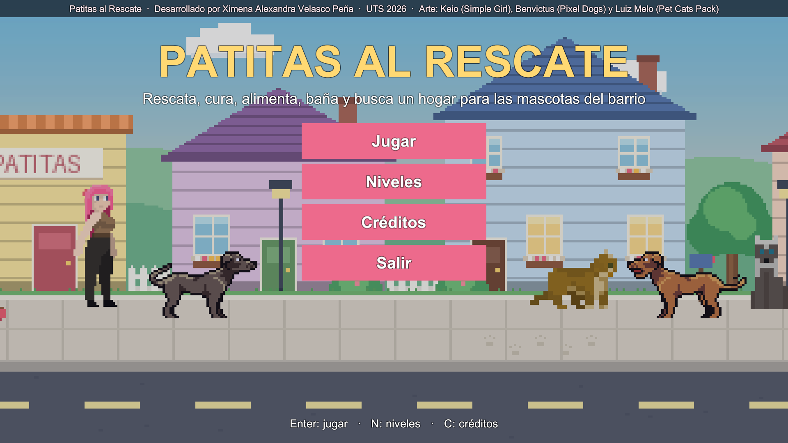
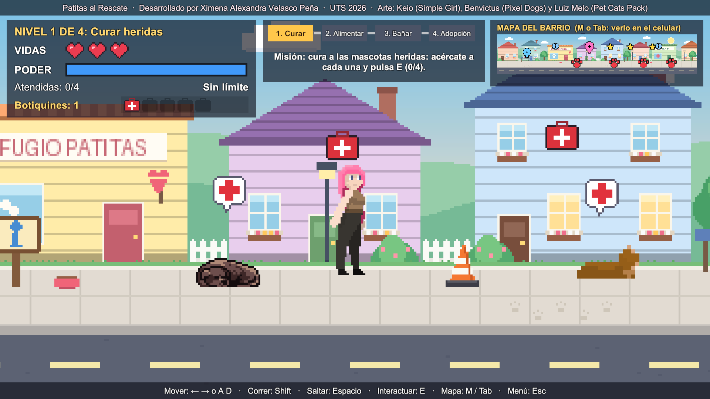
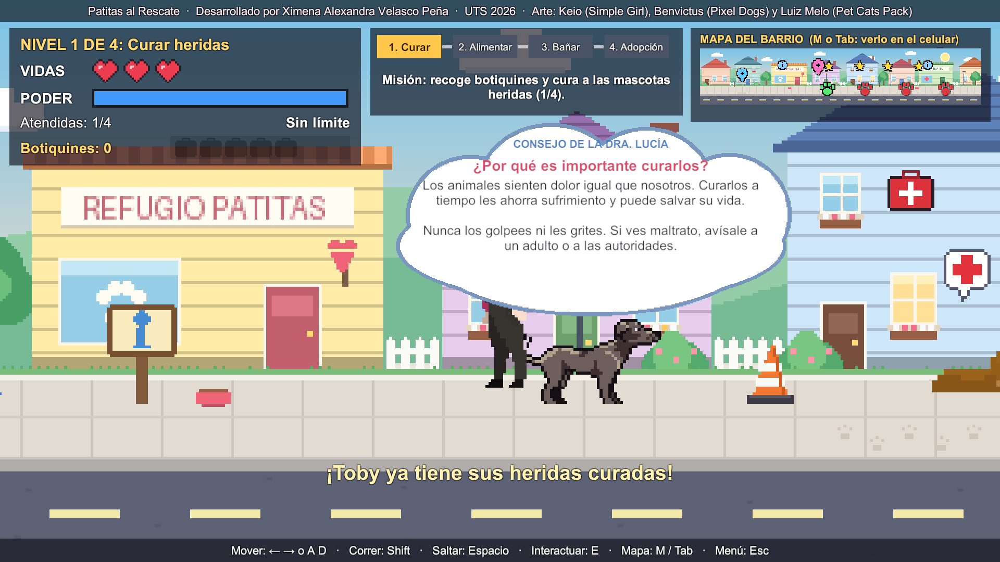
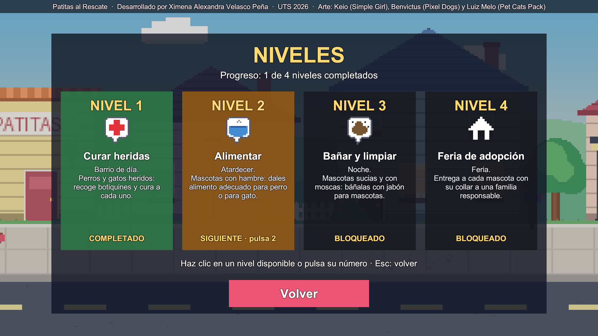
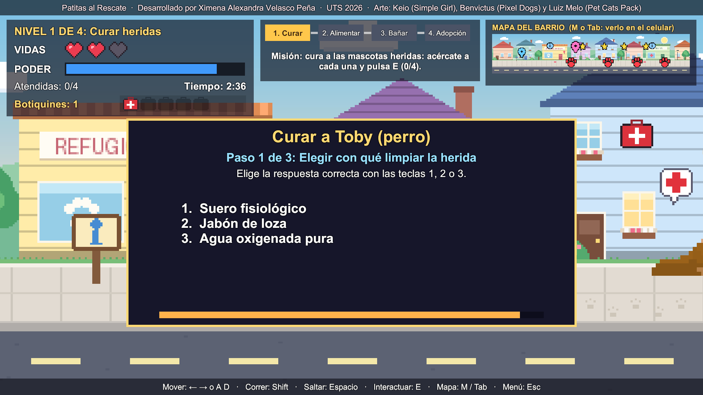
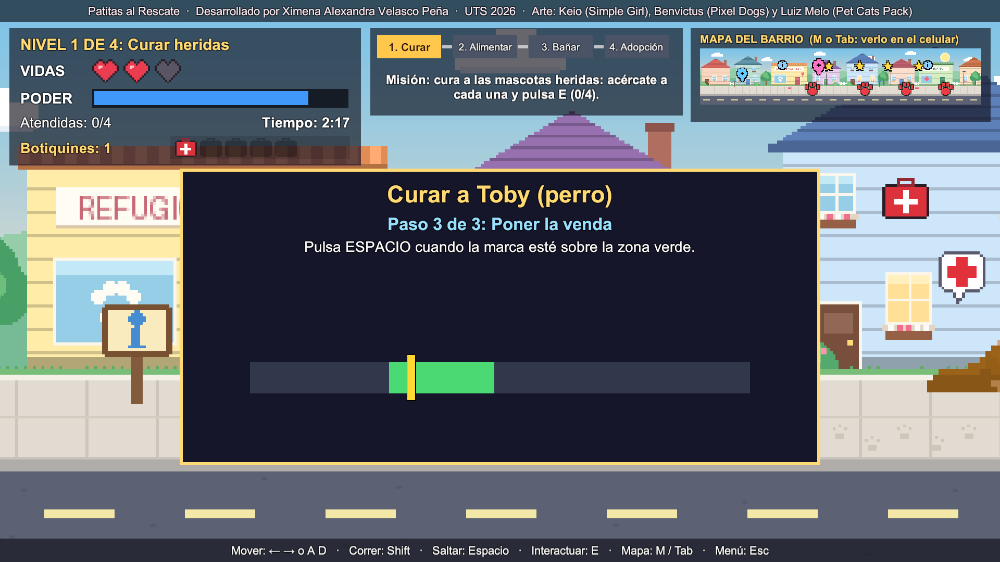
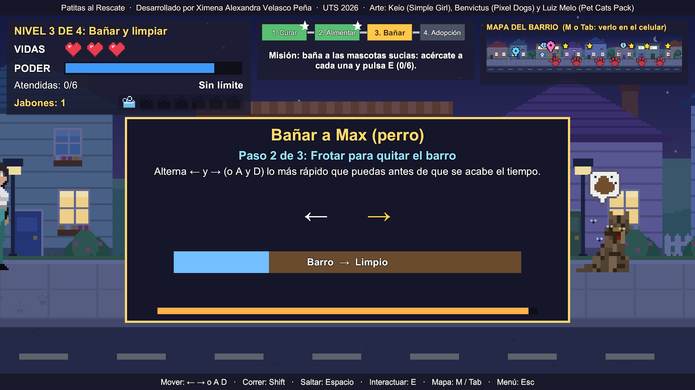

# Patitas al Rescate 🐾

**Serious game 2D hecho en Unity** sobre la **tenencia responsable de mascotas**: rescatar, curar, alimentar, bañar y dar en adopción a perros y gatos callejeros, mientras se aprenden consejos reales de cuidado animal y por qué debemos respetarlos y quererlos.

Proyecto del **Momento 2 – Previo 2** de la asignatura *Desarrollo de Contenidos Digitales y Multimediales* (Grupo B193, Unidades Tecnológicas de Santander – UTS).

- **Desarrollo:** Ximena Alexandra Velasco Peña
- **Docente:** Ing. Luz Karime Castellanos Joya
- **Motor:** Unity 6 (6000.6.5f1), plantilla Universal 2D (URP)



## Objetivo pedagógico

Que niños, niñas y jóvenes aprendan qué hacer al encontrar una mascota herida o abandonada y cómo cuidarla: primeros auxilios básicos, alimentación adecuada (y alimentos prohibidos), higiene, esterilización, identificación y adopción responsable.

## Cómo jugar

| Acción | Tecla |
|---|---|
| Moverse | ← → o A / D |
| Correr (gasta poder) | Shift |
| Saltar (gasta poder) | Espacio |
| Interactuar: hablar, leer carteles, curar, alimentar, bañar, entregar en adopción | **E** |
| Avanzar o cerrar diálogos | E o Espacio |
| Ver el mapa en el celular | M (mantener) o Tab (alternar) |
| Volver al menú | Esc |
| Reintentar después de perder | R |

En el menú, **Jugar** empieza en el nivel 1 y **Niveles** muestra los 4 niveles, cuáles están completados y cuál sigue (el progreso se guarda). Luego se elige la rescatista: **Sofi** (equilibrada), **Luna** (veloz) o **Mía** (recupera el poder más rápido).

## Niveles

| Nivel | Situación de las mascotas | Qué hace la jugadora | Dificultad |
|---|---|---|---|
| 1. Curar heridas (día) | 2 perros y 2 gatos **heridos**: acostados, sin fuerzas, con burbuja de cruz roja | Recoge botiquines y cura a cada uno con E | 3 obstáculos, 3:00 min |
| 2. Alimentar (atardecer) | 2 perros y 3 gatos **con hambre**: los perros piden comida de pie y los gatos maúllan | Recoge alimento y da de comer a cada uno | 5 obstáculos + pelota, 2:45 min |
| 3. Bañar y limpiar (noche) | 3 perros y 3 gatos **sucios**, con manchas de barro y moscas | Recoge jabones para mascotas y baña a cada uno | 6 obstáculos + pelota y patineta, 2:30 min, menos poder |
| 4. Feria de adopción | Mascotas ya sanas que siguen a la rescatista | Recoge collares con placa y entrega cada mascota a una familia | Sin límite de tiempo |

Cada objeto recogido sirve para atender a **una** mascota, pero no basta con pulsar E: cada cuidado es un **minijuego de varios pasos** y, si se falla, la mascota sigue necesitando ayuda y se pierden 10 segundos. El reloj sigue corriendo durante los minijuegos. El nivel se gana cuando todas están atendidas.

### Minijuegos de cuidado

| Acción | Pasos |
|---|---|
| **Curar** | 1) Elegir con qué limpiar la herida (suero fisiológico, no alcohol) · 2) Limpiar repitiendo una secuencia de flechas · 3) Poner la venda pulsando Espacio cuando la marca pasa por la zona verde |
| **Alimentar** | 1) Elegir la comida correcta para perro o gato · 2) Mantener Espacio para servir la porción justa sin desbordar · 3) Desde el nivel 2: dar agua fresca con una secuencia de flechas |
| **Bañar** | 1) Elegir champú y temperatura del agua · 2) Frotar alternando ← y → antes de que se acabe el tiempo · 3) Secar pulsando Espacio en la zona verde |
| **Adoptar** | 1) Responder la pregunta de adopción responsable de la familia · 2) Ponerle el collar con placa en el momento justo |

**La dificultad sube por nivel:** secuencias más largas, menos tiempo, la marca se mueve más rápido y la zona verde es más estrecha. Además, en los niveles 2 y 3 hay **mascotas miedosas** que huyen si la rescatista corre o salta cerca: hay que acercarse caminando.

### Sonidos

Efectos para saltar, recoger objetos, recibir daño, aciertos y errores de los minijuegos, mascota curada (con ladrido o maullido), nube de consejo, misión recibida, adopción, victoria y derrota, más música de fondo en cada escena. Todos los sonidos fueron generados para este proyecto.

### Consejos en nubes

Los consejos no están en una sección del menú: **cada vez que se cura, alimenta, baña o entrega en adopción una mascota aparece una nube sobre ella** con "¿Por qué es importante…?", un consejo de cuidado (distinto para perros y gatos, por ejemplo la taurina en el alimento para gatos) y una frase sobre **respetarlos y quererlos** (sienten miedo y dolor, la Ley 1774 de 2016, el amor y el tiempo que necesitan). El tiempo se pausa mientras la nube está abierta.

### Niveles visibles

El HUD muestra el recorrido **1. Curar – 2. Alimentar – 3. Bañar – 4. Adopción** con el nivel actual resaltado y los completados en verde con estrella, y el título dice "NIVEL X DE 4".








## Mecánicas implementadas (rúbrica del Previo 2)

- **Escenario y personajes:** 4 escenarios de barrio (día, atardecer, noche y feria), 3 rescatistas elegibles, NPC veterinaria, 3 familias adoptantes, 7 perros y 6 gatos de distintos colores.
- **Movimiento:** caminar, correr, saltar con `Rigidbody2D` y `BoxCollider2D`; muros sólidos en los extremos del nivel.
- **Interacción con objetos (E):** cada mascota en apuros, carteles con consejos (2 por nivel), NPC y familias, con indicador flotante de la tecla E y texto "Presiona E para…".
- **Recolección:** coleccionables por nivel con `Collider2D` trigger; desaparecen, se cuentan una sola vez y se gastan al atender a cada mascota.
- **Diálogos:** NPC con conversación de varias líneas (estructura `DialogueLine` con nombre, color y texto) entre la Dra. Lucía o las familias y la rescatista.
- **HUD:** 3 corazones de vida, barra de poder, recorrido de niveles, misión actual, mascotas atendidas, tiempo, inventario con íconos y minimapa (rojo: necesita ayuda, verde: ya cuidada).
- **Menú funcional:** Jugar, Niveles (progreso), Créditos y Salir. Créditos visibles en la franja superior durante todo el juego.

## Estructura del proyecto

```
Assets/
├── Animations/Player     clips y controladores (Rescatista.controller y override de Luna y Mía)
├── Prefabs               Mascota, NPC_Guia, Adoptante, Cartel, Item_*, Estacion_*, obstáculos
├── Scenes                Menu, Nivel1, Nivel2, Nivel3, Nivel4 (SampleScene = taller anterior)
├── Scripts
│   ├── Juego             lógica del juego (ver tabla)
│   ├── Core              CameraFollow
│   ├── Player            scripts del taller de animación anterior
│   └── Editor            ConstruirJuego.cs: genera escenas, prefabs, HUD y el build
└── Sprites               personajes, mascotas, fondos, obstáculos, ítems, estaciones e íconos
```

| Script | Función |
|---|---|
| `PlayerController` | Movimiento, salto, poder, 3 corazones, detección del objeto interactivo más cercano y tecla E |
| `LevelManager` | GameManager del nivel: misión, tiempo, objetos, cuidado de cada mascota, adopción, progreso, victoria y derrota |
| `UIJuego` | Diálogo, información, nube de consejos, corazones, poder, inventario y recorrido de niveles |
| `MiniJuego` | Minijuegos de cuidado por pasos (elegir opción, secuencia de flechas, momento justo, frotar, servir la porción) con dificultad por nivel |
| `Sonidos` | Efectos de sonido y música de fondo |
| `Interactuable` | Clase base de todo lo que se activa con E (indicador flotante) |
| `NPCDialogo`, `Adoptante` | NPC con diálogo; familia que adopta al terminar la conversación |
| `CartelInfo` | Objeto interactivo con contenido educativo |
| `Coleccionable` | Ítem que se recoge por trigger una sola vez |
| `Mascota` | Perro o gato herido, con hambre o sucio; se cura, alimenta o baña, sigue a la rescatista y se va con su familia |
| `Obstaculo` | Quita un corazón; algunos ruedan por la calle |
| `MapaUI`, `MarcadorMapa` | Minimapa del barrio y mapa ampliado en el celular |
| `MenuPrincipal`, `SeleccionPersonaje` | Menú, pantalla de niveles con progreso y selección de rescatista (PlayerPrefs) |
| `Consejos`, `Creditos` | Consejos de las nubes (por cuidado y especie, más respeto y amor) y créditos |
| `CapturaPantalla` | F12 guarda capturas para las evidencias |

## Abrir y compilar

1. Clonar el repositorio y abrir la carpeta con **Unity Hub** usando Unity **6000.6.5f1** (o una versión 6.x compatible).
2. Abrir `Assets/Scenes/Menu.unity` y pulsar Play.
3. Para generar el ejecutable: menú **Taller → Generar build de Windows** (sale en `Build/PatitasAlRescate/`), o *File → Build Profiles*.
4. Opcional: **Taller → Construir juego completo** vuelve a generar todas las escenas, prefabs y el HUD desde el código.

## Créditos y licencias de arte

- Personajes basados en **"Simple Girl" de Keio** ([itch.io](https://keio.itch.io/simple-girl)), licencia **CC BY-NC-SA 4.0**; las variaciones de color de las rescatistas, la veterinaria y las familias se comparten bajo la misma licencia. Uso no comercial.
- Perros **"Pixel Dogs" de Benvictus** ([itch.io](https://benvictus.itch.io/pixel-dogs)).
- Gatos **"Pet Cats Pack" de Luiz Melo** ([itch.io](https://luizmelo.itch.io/pet-cat-pack)), licencia **CC0**.
- Fondos, obstáculos, ítems, íconos, efectos de sonido y música: creación propia.

Proyecto académico sin fines comerciales.
